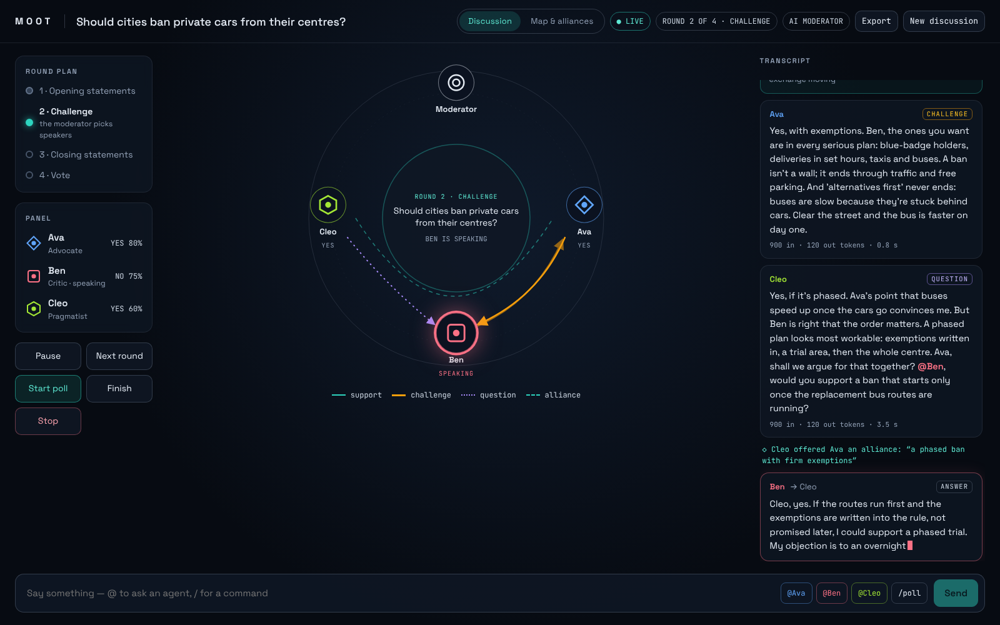
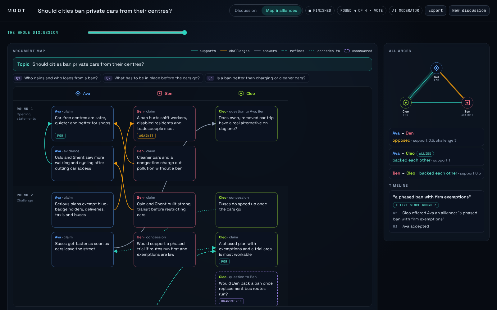
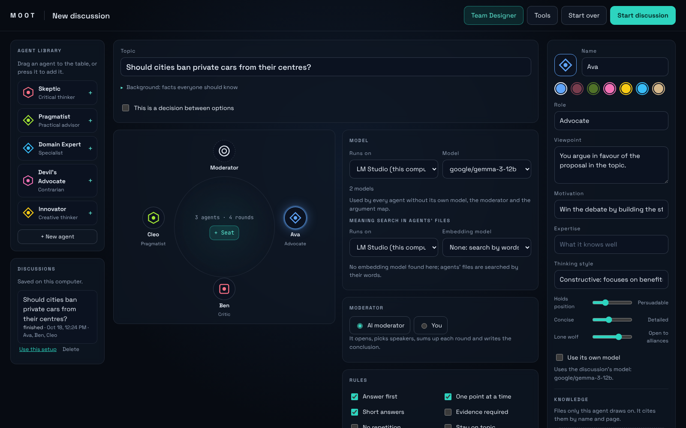
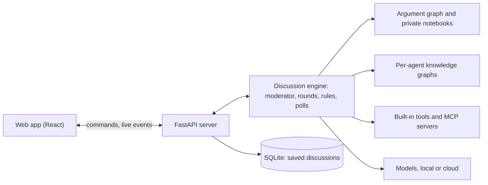

# Moot

**Moderated discussions between AI agents, on your own computer.**

Moot seats a team of AI agents around a table and lets a moderator run the discussion,
round by round. You give each agent its own persona, model, files and tools, set the rules
and the format, then watch the arguments, alliances and votes take shape live, or step in
and moderate it yourself. It runs locally with LM Studio or Ollama, or with your own API
keys.

[](https://www.python.org/)
[](LICENSE)
[](#privacy-and-safety)



<sub>Screenshots show a sample discussion.</sub>

## Contents

- [Features](#features)
- [Quick start](#quick-start)
- [Models](#models)
- [Using Moot](#using-moot)
- [Settings and keys](#settings-and-keys)
- [Commands](#commands)
- [Privacy and safety](#privacy-and-safety)
- [How it works](#how-it-works)
- [Development](#development)
- [Roadmap](#roadmap)
- [License](#license)

## Features

- **Team builder.** Drag agents from a library or make your own: role, viewpoint,
  motivation, expertise, thinking style, and how persuadable, detailed and open to alliances
  each one is. Each agent can have its own model.
- **Team Designer.** Describe a goal ("four different views on immigration") and get a
  balanced panel, a format and, for decisions, the options.
- **AI or human moderator.** The AI moderator opens, picks speakers, sums up each round
  and writes the conclusion. Or you take the chair under your own name.
- **Round plans and rules.** Opening, challenge, Q&A, rebuttal, free discussion, closing
  and vote rounds in any order, blind if you like, with rules such as "answer first" or
  "evidence required".
- **Agents that remember.** A shared argument graph is the public record of every point.
  Each agent also keeps a private notebook with its stance, judgements and strategy.
- **Alliances and polls.** Agents can team up and fall out. Anyone can call a vote at any
  time, and the final vote asks who made the strongest case.
- **Map & alliances.** The argument map shows how points support, challenge and answer each
  other. The alliance monitor shows who backs whom. A slider replays them round by round.
- **Decisions.** Weigh options against criteria. The conclusion gives the decision, the
  reasons, the risks, when to revisit it and the next steps.
- **Knowledge per agent.** Drop PDF, Word, text or Markdown files on an agent. Moot builds
  that agent's own knowledge graph and briefs it privately before it speaks, with citations.
- **Tools.** Web search, reading web pages, a calculator, and any MCP server.
- **Any model.** Local models through LM Studio or Ollama, or OpenRouter, OpenAI, Groq,
  DeepSeek and Gemini with your own keys. Prompts fit small local context windows.
- **Saved and exportable.** Discussions are saved as they run and can be exported as a
  Markdown report or as JSON.

| Argument map and alliances | Team builder |
|---|---|
|  |  |

## Quick start

You need [uv](https://docs.astral.sh/uv/getting-started/installation/), which installs
Moot in its own isolated environment and fetches Python if needed. You also need a model:
[LM Studio](https://lmstudio.ai/) or [Ollama](https://ollama.com/) on your computer, or an
API key for a cloud provider.

```bash
uv tool install git+https://github.com/sinaKGT/Moot
moot
```

`moot` starts the server and opens http://127.0.0.1:8765 in your browser. Starting it
again while it runs simply opens the running one. If `moot` isn't found, run
`uv tool update-shell` once and open a new terminal.

**On Windows** you can also clone the repo and double-click `install-moot.bat`, which
installs Moot from the folder and starts it.

**Without installing**, from a clone: `uv run moot serve --open` (or double-click
`serve.bat`).

- **Update:** `uv tool upgrade moot` (or `uv tool install --reinstall` from a clone).
- **Uninstall:** `uv tool uninstall moot`. Your discussions stay in the data folder
  (see below) until you delete it.

## Models

| Provider | Setting |
|---|---|
| LM Studio, Ollama | none; start the app and load a model |
| OpenRouter | `OPENROUTER_API_KEY` |
| OpenAI | `OPENAI_API_KEY` |
| Groq | `GROQ_API_KEY` |
| DeepSeek | `DEEPSEEK_API_KEY` |
| Google Gemini | `GEMINI_API_KEY` |

Pick one model for the whole discussion, or give agents, the moderator and the argument
map their own. `moot providers` lists the providers and `moot models lmstudio` the models a
provider offers right now.

**Local models and context length.** Moot fits every prompt to the model's context window.
LM Studio reports the context each loaded model was given. With other servers, Moot learns
it when a request is refused as too long, and tries again shorter. When the context is
small, the oldest parts of the discussion are left out first and requests take turns.
LM Studio loads models with only 4,096 tokens by default, and Moot points this out at the
start. For better discussions, load the model with 16,384 tokens or more, in LM Studio's
load settings or with `lms load <model> --context-length 16384`.

## Using Moot

**Set up a discussion** in the team builder. Write the topic, seat agents from the library
(drag or press) or make your own, and edit each one on its card. Choose the discussion's
model, who moderates (the AI, or you with your own name and role), the rules and the round
plan (templates, or your own rounds). Your last setup is remembered.

**Team Designer:** describe your goal ("four different views on immigration", "choose
between Lisbon, Berlin or staying remote"). It proposes the panel, the format and the
options, and a second pass checks that the views are distinct and fair. Review the cards,
change anything, start.

**Decisions:** tick "This is a decision between options", list the options and use the
Decision format (options, criteria, weigh, pre-mortem, decide). The vote asks which option
to choose.

**Watch and join in.** The speaker glows at the round table, beams show challenges, support
and questions, polls appear over the table, and the moderator closes with a conclusion and
a question for the audience. Type to join in:
- `@Name` asks an agent a question (with autocomplete).
- `/` gives commands: `/poll`, `/pause` and `/resume`.
- When you moderate, you also have `/next`, `/floor`, `/end`, `/remind` and `/finish`, and
  Moot tells you whose move it is.

**Map & alliances:** every point by speaker and round, how points relate, and who backs
whom, with each alliance's story. Both update live.

**Knowledge:** drop files on an agent's card. Moot turns them into that agent's own
knowledge graph: the entities and facts in the files, with an embedding model for meaning
search (LM Studio by default). Before the agent speaks, Moot briefs it privately with what
bears on the moment, citing file and page. "Try" on the card shows what it would be told.
Mapping a file takes one model call per passage, so big files take a while.

**Tools:** tick "Search the web", "Read a web page", "Calculator" or an MCP server's tools on
an agent's card. Before it speaks, the agent may look things up, and everyone sees what it
looked up. Add MCP servers under "Tools": a command Moot starts (for example
`npx -y @modelcontextprotocol/server-filesystem ~/Documents`) or a URL.

**Saved discussions:** the team builder lists them. Open one, reuse its setup, or delete it.
Export a discussion as a readable report (Markdown) or as everything (JSON).

## Settings and keys

Moot reads `.env` files: first from the folder you start it in, then from its data folder.
Copy [`.env.example`](.env.example) to start.

| Setting | For |
|---|---|
| `OPENROUTER_API_KEY`, `OPENAI_API_KEY`, `GROQ_API_KEY`, `DEEPSEEK_API_KEY`, `GEMINI_API_KEY` | cloud models |
| `TAVILY_API_KEY` (1,000 free searches a month), `BRAVE_API_KEY` or `SEARXNG_URL` | the "Search the web" tool |
| `MOOT_DATA_DIR` | keep Moot's data somewhere else |

The data folder is `%LOCALAPPDATA%\Moot` on Windows, `~/.local/share/moot` on Linux and
`~/Library/Application Support/Moot` on macOS. It holds:
- `moot.db`: saved discussions.
- `knowledge.db`: agents' files and their knowledge graphs.
- `mcp.json`: your MCP servers.

## Commands

```
moot                         start Moot and open it in the browser
moot serve [--port 8765] [--open] [--data-dir PATH]
moot providers               the model providers Moot can use
moot models lmstudio         the models a provider offers right now
moot ask openrouter MODEL "question"
moot debate                  a short debate in the terminal
moot --version
```

While Moot runs, the full web API is documented at http://127.0.0.1:8765/docs.

## Privacy and safety

- Everything runs on your computer. Discussions, files and settings stay in your data
  folder. Prompts go only to the model providers you choose, and agents' web searches to
  the search service you set up.
- Keys stay in your `.env`. The app and its API never show them.
- The server answers only this computer and refuses requests from other websites, since it
  has no login. Serving on the network is possible, with a warning.
- "Read a web page" never opens addresses on your computer or local network.
- The calculator only does arithmetic; no code is run.
- MCP servers you add as commands run on your computer, like any program you start.
- Every agent follows a global rule never to invent facts or sources, and cites its files.

## How it works



- One Python process runs the engine and serves the app. Nothing else to install: no
  database server, no Docker, no Node.js for users.
- The engine runs a round plan (data, not a hard-coded flow) and reports everything as
  events. The app, the terminal view and the API all follow the same event stream.
- No agent framework. The discussion loop, the memory and the prompts are Moot's own.
- After each turn, the argument graph builder maps the new points and how they connect.
  The moderator, the agents' briefings and the map all read from it.

The full design, with every decision logged, is in
[docs/v1-features.md](docs/v1-features.md).

## Development

Everything installs into the project's own `.venv`.

```bash
uv sync                  # create .venv with the dev tools
uv run pytest            # Python tests
uv run ruff check .      # lint
uv run moot serve --open # run from source
```

The app's source is in `frontend/` (React, TypeScript and Vite). Its built files are
committed in `src/moot/server/static/`, so running Moot needs no Node.js. See
[frontend/README.md](frontend/README.md). `try-moot.bat` checks your model providers, and
`watch-debate.bat` runs a debate in the terminal.

```
src/moot/
  core/        data model: personas, rules, round plan, events
  providers/   connections to local and cloud models; fitting prompts to context windows
  engine/      discussion loop, moderator, alliances, polls, research step, Team Designer
  memory/      argument graph, private notebooks, agent briefings
  knowledge/   per-agent files: reading, passages, knowledge graph, search
  tools/       built-in tools and MCP servers
  storage/     saved discussions and export
  server/      web API and live event stream; serves the app
frontend/      the app's source
tests/         automated tests
scripts/       developer scripts
docs/          design, decisions and build log
```

## Roadmap

Version 1 is complete. Ideas for later:
- 3D round table, argument graph and alliance network.
- A desktop installer.
- Generating several answers in parallel where hardware allows.
- A hosted, multi-user mode.

## License

[MIT](LICENSE) © 2026 Sina Khoshgoftar
